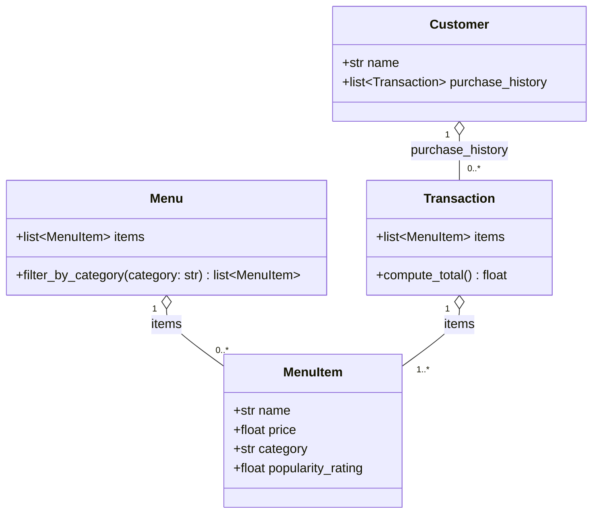

# ByteBites Class Diagram

## Plain-text version

+-----------------------------+        +-------------------------------+
|          Customer           |        |             Menu              |
+-----------------------------+        +-------------------------------+
| name: str                   |        | items: list[MenuItem]         |
| purchase_history:           |        +-------------------------------+
|   list[Transaction]         |        | filter_by_category(category)  |
+-----------------------------+        |   -> list[MenuItem]           |
              | 1                      +-------------------------------+
              |                                       | 1
              | 0..*                                  | 0..*
+-----------------------------+        +-------------------------------+
|         Transaction         | 1..*   |           MenuItem            |
+-----------------------------+------->+-------------------------------+
| items: list[MenuItem]       |        | name: str                     |
+-----------------------------+        | price: float                  |
| compute_total() -> float    |        | category: str                 |
+-----------------------------+        | popularity_rating: float      |
                                       +-------------------------------+

## Assumptions

- `purchase_history` is a list of `Transaction` objects. It's only stored data, with no verification logic.
- A `Transaction` holds references to `MenuItem` objects and doesn't own them. That's why the diagram uses aggregation (hollow diamond) rather than composition.
- A `Transaction` needs at least one item (`1..*`). A `Menu` or a purchase history can be empty (`0..*`).
- The types are guesses: `price` and `popularity_rating` as `float`, `name` and `category` as `str`.
- A `Transaction` can contain the same item more than once, since there's no quantity attribute.
