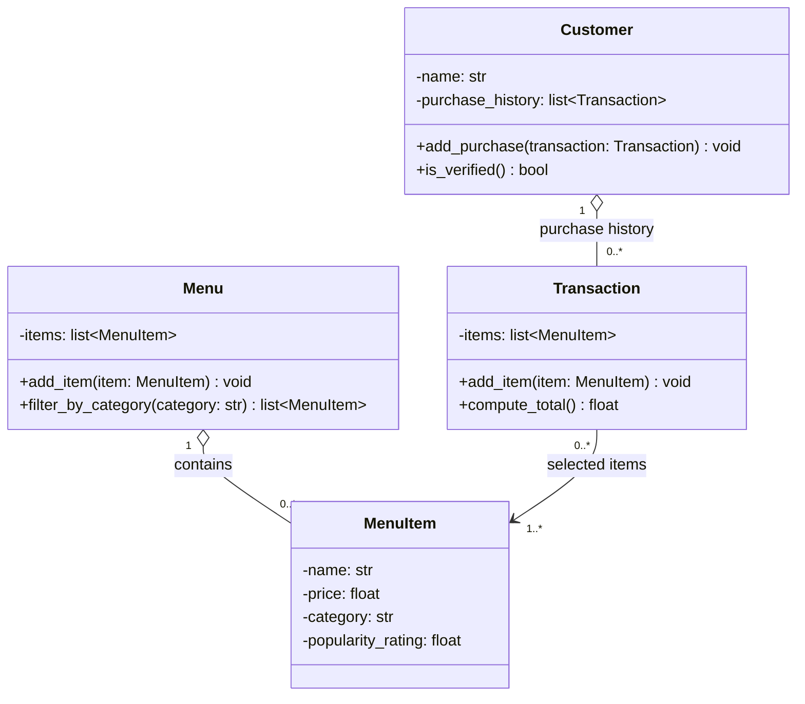

# ByteBites UML Class Diagram



## Plain-text version

```
┌──────────────────────────┐            ┌──────────────────────────┐
│        Customer          │            │       Transaction        │
├──────────────────────────┤ 1     0..* ├──────────────────────────┤
│ - name: str              │◇───────────│ - items: list[MenuItem]  │
│ - purchase_history:      │            ├──────────────────────────┤
│     list[Transaction]    │            │ + add_item(item)         │
├──────────────────────────┤            │ + compute_total(): float │
│ + add_purchase(txn)      │            └────────────┬─────────────┘
│ + is_verified(): bool    │                         │ 0..*
└──────────────────────────┘                         │
                                                     ▼ 1..*
┌──────────────────────────┐ 1     0..* ┌──────────────────────────┐
│          Menu            │◇──────────▶│        MenuItem          │
├──────────────────────────┤            ├──────────────────────────┤
│ - items: list[MenuItem]  │            │ - name: str              │
├──────────────────────────┤            │ - price: float           │
│ + add_item(item)         │            │ - category: str          │
│ + filter_by_category(    │            │ - popularity_rating:     │
│     category): list      │            │     float                │
└──────────────────────────┘            └──────────────────────────┘
```

## Relationships

- **Customer ◇── Transaction (aggregation, 1 to 0..\*):** a customer's purchase history is a list of past transactions. A new customer starts with none. `is_verified()` uses that history, since the spec says it's how the system checks that someone is a real user.
- **Menu ◇── MenuItem (aggregation, 1 to 0..\*):** the menu holds the full catalog, and `filter_by_category("Drinks")` returns only the items in that category.
- **Transaction ──▶ MenuItem (association, 0..\* to 1..\*):** a transaction points to the items that were picked but doesn't own them. One item, like "Large Soda", can show up in many transactions. `compute_total()` adds up the `price` of each item.

## Assumptions not stated in the spec

- `add_item`, `add_purchase` and `is_verified` are small helper methods added for convenience.
- A transaction needs at least one item (`1..*`).
- Aggregation is used instead of composition because menu items and transactions can exist on their own.
